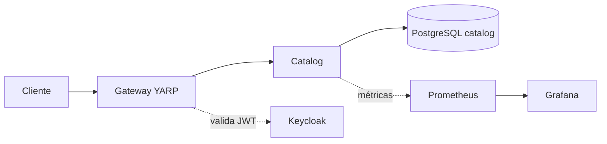

# Design: Fundação da plataforma

## Visão geral
Gateway (YARP) na borda valida o token do Keycloak e encaminha ao `Catalog` (esqueleto). Todos rodam em containers na rede `internal`. Telemetria via OpenTelemetry → Prometheus → Grafana.

## Decisões
- ADR-0001 (microsserviços em monorepo), ADR-0002 (Keycloak), ADR-0005 (PostgreSQL por serviço).

## Arquitetura lógica e física

## Contratos
- Gateway expõe `/catalog/**` → `Catalog /v1/**`.
- Sem eventos nesta fase.

## Modelo de dados
Banco `catalog` vazio, com migração inicial do EF Core.

## Fluxos e tratamento de falhas
- Timeout de 5 s no proxy do Gateway.
- Se o Catalog cair, o Gateway responde 503 e o `CorrelationId` aparece nos logs.

## Segurança
Validação de JWT no Gateway **e** no Catalog (`Auth:Authority`, `Auth:Audience`). `/health/*` anônimo.

## Observabilidade
Métricas HTTP, runtime .NET, logs JSON, traces OTLP.

## Testes
Arquitetura (NetArchTest), integração do endpoint de health com Testcontainers, CI no GitHub Actions.

## Riscos
Complexidade inicial do Compose; mitigada com profiles e healthchecks.
