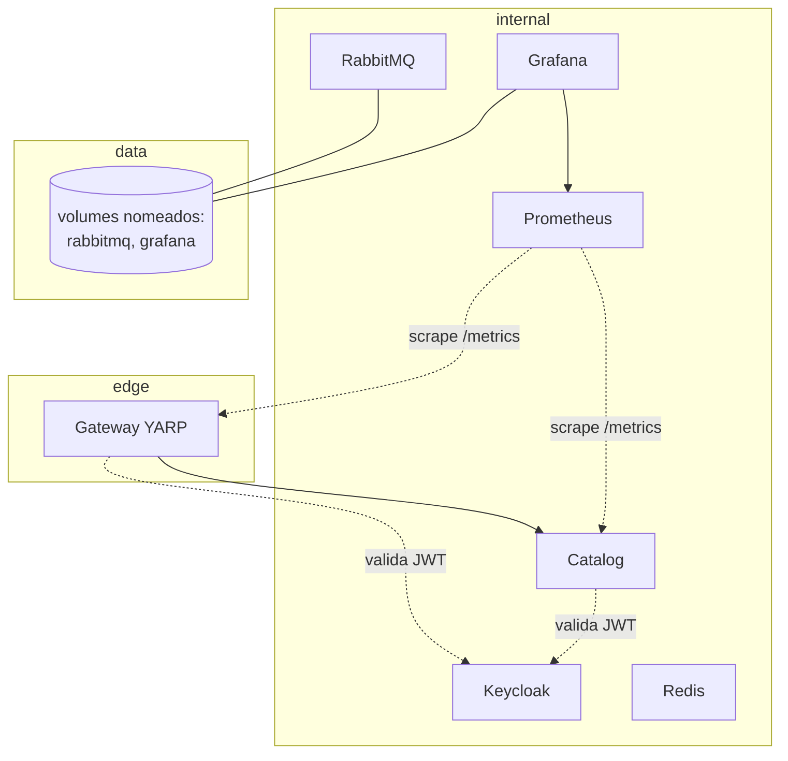

# Design: Infraestrutura base (plataforma compartilhada)

## Visão geral
Reescrever o `docker-compose.yml` base para ser a **plataforma compartilhada** do OrderHub (Keycloak, RabbitMQ, Redis, Prometheus, Grafana), com redes segmentadas, volumes nomeados e limites de recurso. Os serviços .NET continuam no `docker-compose.services.yml`; o `docker-compose.override.yml` passa a conter apenas overrides de dev de serviços que existem no base. Adicionam-se os projetos `BuildingBlocks` (contratos de evento e abstrações de mensageria, sem implementação de broker).

## Decisões (com links para ADRs)
- **RabbitMQ como broker** — ADR 0003. A implementação de `IEventBus` fica para a fase 03; aqui só as abstrações.
- **PostgreSQL por serviço** — ADR 0005. Nenhum banco sobe nesta fase; cada um nasce na fila do seu serviço.
- **Handlers sem mediator** — ADR 0004. Os `BuildingBlocks` não introduzem mediator; só contratos e `IEventBus`.
- **Interfaces agora, implementação na 03:** evita código de broker sem teste de integração que o exercite.
- **Topologia RabbitMQ por serviço** — ADR 0006. Exchanges/filas são declaradas pelo código de cada serviço na sua fase, não pré-criadas aqui.

## Arquitetura lógica e física

**Redes:**
- `edge`: borda pública; só o Gateway e o Keycloak (login) ficam alcançáveis a partir dela.
- `internal`: comunicação entre serviços e infra de apoio (broker, cache, observabilidade).
- `data`: reservada para bancos; sem serviço com estado de banco nesta fase, mas declarada para as fases seguintes.

**Exposição ao host (apenas dev, via override):** Keycloak `8180`, RabbitMQ `15672`/`5672`, Prometheus `9090`, Grafana `3000`, Redis `6379`, Gateway `5000`, Catalog `5001`. Nada de infra com estado é exposto fora do profile `debug`.

**Limites de recurso:** cada serviço declara `cpus` e `mem_limit` (base para o laboratório de cgroups na fase 08).

## Contratos

### API HTTP/gRPC
Sem novos endpoints. Mantêm-se `/health/live`, `/health/ready` e `/metrics` dos serviços existentes.

### Eventos publicados / consumidos
Nenhum evento concreto nesta fase. Define-se apenas o **envelope** em `OrderHub.BuildingBlocks.Contracts`:

| Campo | Tipo | Descrição |
|---|---|---|
| `MessageId` | `Guid` | Identificador único da mensagem |
| `OccurredAt` | `DateTimeOffset` | Instante do evento na origem |
| `CorrelationId` | `string` | Correlação ponta a ponta |
| `CausationId` | `string?` | Mensagem que causou esta |
| `Type` | `string` | Nome lógico do evento |
| `Version` | `int` | Versão do contrato |
| `Producer` | `string` | Serviço de origem |

`IEventBus` (em `OrderHub.BuildingBlocks.Messaging`) expõe publicação assíncrona; a implementação concreta (RabbitMQ) vem na fase 03.

## Modelo de dados
Nenhum. Sem schema nem migrations nesta fase.

## Fluxos e tratamento de falhas
- `depends_on` com `condition: service_healthy` encadeia o boot (infra saudável antes dos serviços).
- Healthcheck por container; serviços sem `curl` na imagem (Keycloak) usam o endpoint de management.
- `/health/ready` de um serviço falha quando uma dependência essencial some (Requisito 7); exercitado no experimento derrubando o RabbitMQ.
- Volumes nomeados garantem durabilidade de dados do broker e do Grafana entre reinícios.

## Segurança (escopos e policies)
Sem mudança no modelo de autenticação. Keycloak migra para o base de infra mantendo o realm `orderhub`, o issuer estável (`KC_HOSTNAME`) e o import no boot.

## Observabilidade (métricas, logs, traces)
- Prometheus com os jobs já definidos (`prometheus`, `catalog`, `gateway`); novos targets entram por fase.
- Grafana com datasource e dashboard provisionados.
- Logs estruturados com `CorrelationId`/`TraceId` já vindos da fase 01.

## Testes (unitário, integração, arquitetura, carga, caos)
- **Arquitetura:** teste garantindo que `BuildingBlocks.Contracts` e `BuildingBlocks.Messaging` não referenciam projeto de serviço algum.
- **Composição:** `docker compose config` validado no CI.
- **Caos (experimento):** derrubar RabbitMQ e observar `/health/ready` + Prometheus.

## Riscos e alternativas descartadas
- **Subir os cinco Postgres agora (descartado):** geraria migrations órfãs e consumo de recursos sem conceito exercitado; decidido um banco por fase.
- **Implementar `IEventBus` sobre RabbitMQ agora (descartado):** código de broker sem teste de integração que o use; adiado para a fase 03.
- **Pré-criar exchanges/filas (descartado):** topologia fica acoplada ao serviço que a usa; cada serviço declara a sua.
