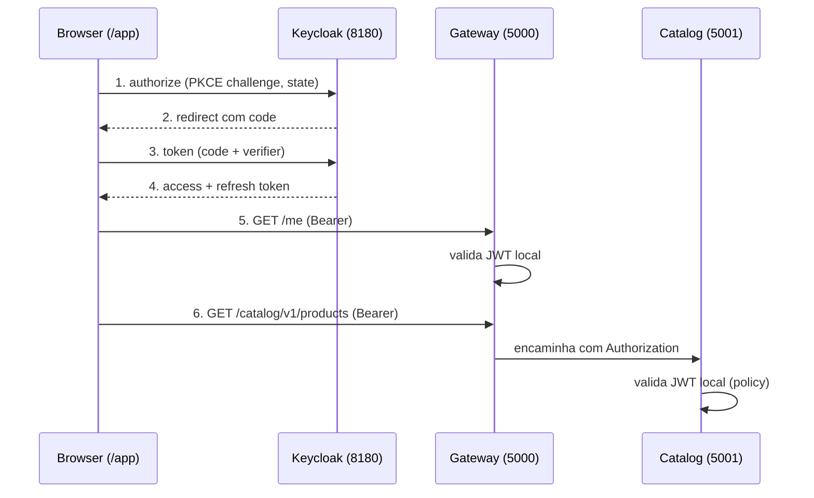

# Design: Login de usuários com OAuth 2.0 (Authorization Code + PKCE)

## Visão geral
O login ocorre no Keycloak (realm `orderhub`). Um cliente web mínimo servido pelo Gateway em `/app` executa Authorization Code + PKCE (S256) em JavaScript puro. As APIs continuam *resource servers*: validam o JWT localmente. A configuração JwtBearer hoje duplicada em Gateway e Catalog é extraída para `OrderHub.BuildingBlocks.Auth`, que também registra as policies de autorização.

## Decisões (com links para ADRs)
- **ADR 0006 (novo):** Authorization Code + PKCE para usuários finais; `client_credentials` permanece para chamadas serviço→serviço. A identidade chega aos serviços pela propagação do header `Authorization` feita pelo Gateway.
- Autorização combina **escopo E papel**: o escopo delimita a operação, o papel delimita quem pode.
- Tokens no cliente ficam **em memória**; `sessionStorage` guarda apenas `code_verifier` e `state`.

## Arquitetura lógica e física

## Contratos
### API HTTP/gRPC
- `GET /me` (Gateway, exige token): `{ sub, preferred_username, roles[], scopes[], exp }`.
- `GET /app/*` (Gateway, anônimo): `index.html` + `app.js` via `UseStaticFiles`.
- Endpoints de negócio existentes passam a exigir token; rotas YARP não capturam `/app` nem `/me`.

### Eventos publicados / consumidos
Nenhum nesta spec.

## Modelo de dados
Sem banco. Realm, roles, usuários e clients são configuração do Keycloak (`deploy/keycloak/orderhub-realm.json`).

## Fluxos e tratamento de falhas
- Keycloak fora do ar: tokens válidos seguem aceitos (JWKS em cache); novos logins falham.
- Token expirado: `401`; o cliente tenta refresh e, se falhar, reinicia o login.
- `ClockSkew` do JwtBearer reduzido para 30 s (padrão é 5 min) para tornar a expiração observável no experimento.

## Segurança (escopos e policies)
- Realm roles: `customer` (padrão de novos usuários) e `admin`. Usuários dev: `alice`/`alice123` (customer), `bob`/`bob123` (admin). Auto-cadastro habilitado; access token 300 s; refresh habilitado.
- Client público `orderhub-web`: standard flow, PKCE S256, sem secret, direct grants desligado, redirect `http://localhost:5000/app/*`, web origin `http://localhost:5000`.
- Client scopes (todos com audience mapper `orderhub-api`): `catalog.read`, `catalog.write`, `inventory.read`, `inventory.write`. Mapper publica realm roles em claim plano `roles`. Ambos os clients recebem os scopes e o mapper como default.
- Policies: `CatalogRead` (scope catalog.read); `CatalogWrite` (scope catalog.write E role admin); `InventoryRead` (scope inventory.read E role admin); `InventoryWrite` (scope inventory.write E role admin); `AdminOnly` (role admin). `scope` é string separada por espaços; `roles` é lista.
- `ICurrentUser` (porta na Application do Catalog): `UserId` (`sub`), `UserName` (`preferred_username`), `Roles`, `Scopes`; implementação na Api com `IHttpContextAccessor`.

## Observabilidade (métricas, logs, traces)
Logs estruturados com `CorrelationId`/`TraceId` já existentes; nunca logar tokens. `/me` e falhas 401/403 registram o motivo sem o token.

## Testes (unitário, integração, arquitetura, carga, caos)
- Matriz de autorização por endpoint × identidade (anônimo, alice, bob, orderhub-cli) → 401/403/200.
- Teste de arquitetura (NetArchTest): `BuildingBlocks.Auth` é só técnico, não referencia projeto de serviço.
- Experimento de caos: parar o Keycloak; experimento de tempo: token de 30 s + ClockSkew 30 s.

## Riscos e alternativas descartadas
- **Guardar tokens em `localStorage` (descartado):** maior exposição a XSS; mantidos em memória.
- **Direct access grants (password) no cliente (descartado):** não usa PKCE e expõe credenciais; usado só o fluxo de código.
- **Autorização só por escopo (descartado):** não distingue quem pode; combinamos escopo E papel.

## Decisões e suposições
- Suposição: o cliente web mínimo basta para exercitar o fluxo; sem framework nem build step.
- Suposição: o realm JSON existente é editável para adicionar roles, usuários, o client `orderhub-web`, os scopes e os mappers; se o import no boot não recriar, documenta-se o ajuste manual no experimento.
- ADR numerado como 0006 por ser a próxima decisão registrada após a 0005.