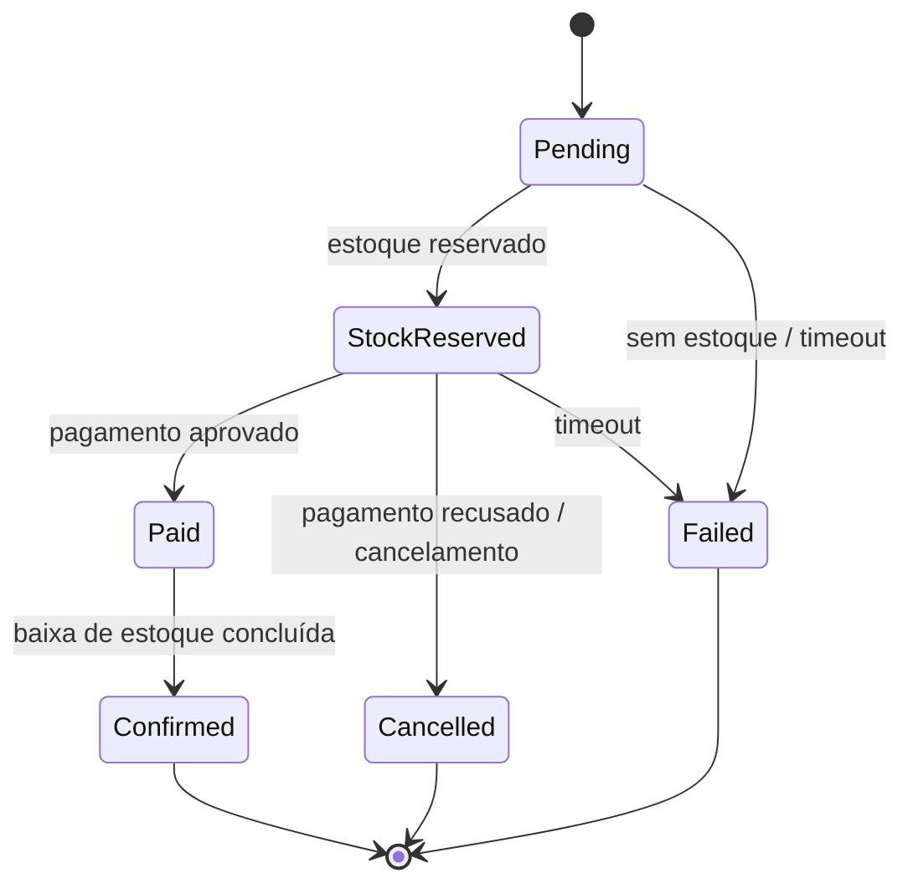
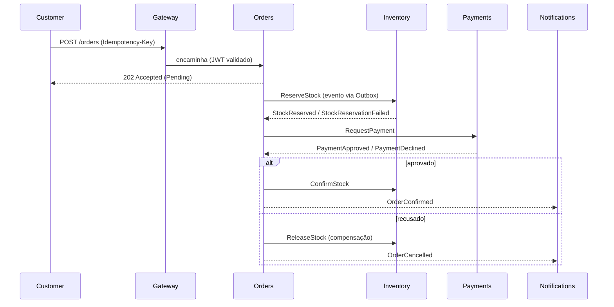

# OrderHub: ideia do projeto

> **Status:** rascunho v0.1 (2026-10-23). As regras de negócio abaixo são ponto de partida, não contrato. Serão refinadas nas specs de cada fase (`.kiro/specs/`). Mudanças relevantes viram ADR em `docs/adr/`.

## 1. Visão geral

O OrderHub é um **e-commerce simplificado**, construído em microsserviços, cujo propósito principal é **servir de laboratório para a disciplina de Sistemas Distribuídos** (Coulouris, Dollimore e Kindberg, *Sistemas Distribuídos: Conceitos e Projeto*, 2007).

O negócio é deliberadamente pequeno: o cliente consulta produtos, faz um pedido, o sistema reserva o estoque, cobra o pagamento e notifica o resultado. Essa jornada simples atravessa vários serviços, e é nessa travessia que aparecem os problemas clássicos da disciplina: falhas parciais, mensagens duplicadas ou perdidas, consistência entre bancos distintos, concorrência por estoque, disponibilidade e desempenho.

**Princípio de projeto:** nenhuma funcionalidade existe só pelo negócio. Cada uma deve exercitar pelo menos um tópico de Sistemas Distribuídos e produzir uma evidência (experimento reproduzível).

## 2. Objetivos

**Didáticos (prioridade):**
- Aplicar na prática os conceitos de arquitetura lógica e física, comunicação, consistência, replicação, tolerância a falhas, transações distribuídas, segurança, alta disponibilidade e balanceamento de carga.
- Medir e analisar desempenho e comportamento sob falha, não apenas "fazer funcionar".

**De negócio (suficiente para dar contexto):**
- Permitir catálogo, pedido, pagamento simulado e notificação de ponta a ponta.

## 3. Atores

| Ator | Descrição |
|---|---|
| **Customer** | Consulta produtos, faz e acompanha pedidos |
| **Admin** | Gerencia produtos e estoque |
| **Sistema (serviços)** | Serviços que se autenticam entre si (`client_credentials`) |
| **Operador/Aluno** | Quem executa experimentos: derruba containers, injeta falhas, roda testes de carga |

## 4. Escopo

**Dentro:** catálogo, estoque, pedidos, pagamento simulado, notificações, autenticação/autorização, observabilidade, deploy em containers e VMs.

**Fora (por ora):** frete, cupons, avaliações, recomendação, carrinho persistente multi-dispositivo, pagamento real, front-end elaborado (um cliente simples ou chamadas via HTTP bastam), multi-moeda, impostos.

## 5. Funcionalidades, regras de negócio e tópicos de SD

Convenção: `RN-<SERVIÇO>-NN` = regra de negócio (rascunho). Em cada serviço, a tabela final liga as funcionalidades aos tópicos da disciplina.

### 5.1 Catalog (catálogo de produtos)

**O que faz:** lista e consulta produtos; admin cadastra, edita e desativa produtos; produtos podem ter imagem.

**Regras (rascunho):**
- RN-CAT-01: todo produto tem `Sku` único, nome, descrição, preço e moeda.
- RN-CAT-02: preço deve ser maior que zero.
- RN-CAT-03: produto desativado não aparece na listagem do cliente, mas continua visível em pedidos antigos.
- RN-CAT-04: o preço do produto no momento do pedido é **copiado** para o pedido (mudanças posteriores não alteram pedidos existentes).
- RN-CAT-05: somente Admin cria, altera e desativa produtos; Customer só lê.
- RN-CAT-06: listagem é paginada.

| Funcionalidade | Tópico de SD |
|---|---|
| Consulta de produtos via Gateway | **Cliente-servidor**; timeouts; transparência de localização |
| Cache de leitura (Redis) | **Replicação** e **consistência** (cache obsoleto, TTL, invalidação) |
| Réplica de leitura do banco | **Replicação**; janela de inconsistência |
| Imagens do produto (MinIO) | **Sistemas de arquivos distribuídos** |
| Escopos `catalog.read` / `catalog.write` | **Segurança**: autorização distribuída |

### 5.2 Inventory (estoque)

**O que faz:** mantém a quantidade disponível por produto; reserva estoque para um pedido; libera ou confirma a reserva.

**Regras (rascunho):**
- RN-INV-01: nunca é possível reservar mais do que o disponível (sem estoque negativo).
- RN-INV-02: a reserva é **por pedido** e **idempotente**: reservar duas vezes o mesmo pedido não consome estoque duas vezes.
- RN-INV-03: a reserva **expira** após um tempo limite (ex.: 15 min) se o pedido não for confirmado.
- RN-INV-04: pedido cancelado ou pagamento recusado **libera** a reserva.
- RN-INV-05: pedido confirmado converte a reserva em **baixa definitiva**.
- RN-INV-06: somente Admin ajusta estoque manualmente.
- RN-INV-07: quando a reserva de um pedido com vários itens falha parcialmente, nenhum item fica reservado (tudo ou nada por pedido).

| Funcionalidade | Tópico de SD |
|---|---|
| Disputa por último item em pedidos simultâneos | **Controle de concorrência** (otimista com versão de linha) |
| Seções críticas pontuais | **Sincronização** e **exclusão mútua** (lock distribuído com TTL e *fencing token*) |
| Reserva idempotente | **Semânticas de entrega** (at-least-once + idempotência) |
| Expiração de reserva | **Tempo e timeouts** em sistemas assíncronos |
| Consumo de eventos de pedido | **Troca de mensagens**; Inbox |

### 5.3 Orders (pedidos)

**O que faz:** cria o pedido, **orquestra a Saga** (estoque → pagamento → confirmação), permite consultar e cancelar.

**Regras (rascunho):**
- RN-ORD-01: um pedido tem pelo menos um item; quantidade de cada item maior que zero.
- RN-ORD-02: o cliente só enxerga os **seus** pedidos; Admin enxerga todos.
- RN-ORD-03: o total é calculado no servidor a partir dos preços congelados (RN-CAT-04), nunca enviado pelo cliente.
- RN-ORD-04: a criação de pedido aceita `Idempotency-Key`; repetir a requisição com a mesma chave devolve o mesmo pedido.
- RN-ORD-05: cancelamento só é permitido antes da confirmação; depois, só por fluxo de estorno (fora do escopo inicial).
- RN-ORD-06: se a Saga não terminar em um limite de tempo, o pedido vai para `Failed` e as compensações são executadas.
- RN-ORD-07: toda mudança de estado gera um evento publicado via Outbox.

**Estados do pedido:**

**Fluxo principal (Saga orquestrada):**

| Funcionalidade | Tópico de SD |
|---|---|
| Saga orquestrada com compensações | **Transações distribuídas**; por que evitar 2PC |
| Publicação de eventos com Outbox | **Troca de mensagens** confiável; atomicidade local + entrega assíncrona |
| Resposta `202 Accepted` e estado consultável | **Consistência eventual**; modelo assíncrono |
| `Idempotency-Key` | Semânticas de invocação (talvez-uma-vez, pelo-menos-uma-vez, no-máximo-uma-vez) |
| Timeout da Saga | **Modelo de falhas** (omissão, crash) e detecção de falhas |
| Autorização por dono do pedido | **Segurança**: identidade propagada entre serviços |

### 5.4 Payments (pagamentos, simulado)

**O que faz:** simula a cobrança e devolve aprovado, recusado ou indisponível. Permite **injetar falhas** de forma controlada para os experimentos.

**Regras (rascunho):**
- RN-PAY-01: um pedido tem no máximo um pagamento aprovado (idempotência por `OrderId`).
- RN-PAY-02: o resultado pode ser `Approved`, `Declined` ou `Unknown` (timeout/indisponibilidade).
- RN-PAY-03: resultado `Unknown` **não** é tratado como recusa; o sistema consulta/reconcilia depois antes de compensar.
- RN-PAY-04: o modo de simulação (aprovação sempre, recusa por valor, latência alta, queda aleatória, queda total) é configurável por variável de ambiente ou endpoint administrativo.
- RN-PAY-05: nenhum dado real de cartão é armazenado.

| Funcionalidade | Tópico de SD |
|---|---|
| Latência e falhas injetáveis | **Tolerância a falhas**; modelo de falhas na prática |
| Estado `Unknown` e reconciliação | Incerteza em sistemas assíncronos; **at-most-once vs at-least-once** |
| Retry + circuit breaker | **Resiliência** (backoff com jitter, abertura de circuito) |
| Estorno/compensação | **Transações distribuídas**: compensação semântica |
| Chamada Orders → Payments por gRPC (fase 7) | **Invocação remota**, *marshalling*, comparação com REST |

### 5.5 Notifications (notificações)

**O que faz:** reage a eventos de pedido e "notifica" o cliente (e-mail/SMS simulado: grava em log e em tabela).

**Regras (rascunho):**
- RN-NOT-01: uma notificação por evento relevante (`OrderConfirmed`, `OrderCancelled`, `OrderFailed`).
- RN-NOT-02: eventos duplicados não geram notificações duplicadas.
- RN-NOT-03: falha ao notificar **não** afeta o pedido (acoplamento fraco).

| Funcionalidade | Tópico de SD |
|---|---|
| Assinatura de eventos (topic exchange) | **Comunicação em grupo**; pub/sub |
| Descarte de duplicatas | **Consumer idempotente** (Inbox) |
| Serviço desacoplado do fluxo crítico | **Middleware**; desacoplamento no tempo e no espaço |
| Várias instâncias consumindo | *Competing consumers*; balanceamento |

### 5.6 Identidade e acesso (Keycloak + Gateway)

**O que faz:** autentica usuários e serviços; o Gateway é a entrada única.

**Regras (rascunho):**
- RN-AUTH-01: papéis `customer` e `admin`; escopos por serviço (`catalog.read`, `orders.write`...).
- RN-AUTH-02: Gateway **e** serviços validam o token (defesa em profundidade).
- RN-AUTH-03: comunicação serviço a serviço usa `client_credentials`, com um client por serviço.
- RN-AUTH-04: `/health/*` é público; todo o resto exige token.

| Funcionalidade | Tópico de SD |
|---|---|
| OAuth 2.0 / OIDC | **Segurança**: autenticação e autorização distribuídas |
| Validação de JWT local em cada serviço | Confiança sem consulta central a cada requisição |
| Gateway como ponto de entrada | **Cliente-servidor**; balanceamento de carga; transparência |
| TLS/mTLS entre serviços (fase posterior) | Canais seguros |

## 6. Catálogo de eventos (rascunho)

Contratos em `OrderHub.BuildingBlocks.Contracts`, com sufixo de versão. Envelope: `MessageId`, `OccurredAt`, `CorrelationId`, `CausationId`, `Type`, `Version`, `Producer` (e `LamportTimestamp` na fase 8).

| Evento | Publicado por | Consumido por |
|---|---|---|
| `OrderPlacedV1` | Orders | Inventory, Notifications |
| `StockReservedV1` / `StockReservationFailedV1` | Inventory | Orders |
| `PaymentRequestedV1` | Orders | Payments |
| `PaymentApprovedV1` / `PaymentDeclinedV1` / `PaymentUnknownV1` | Payments | Orders |
| `StockReleasedV1` | Inventory | Orders |
| `OrderConfirmedV1` / `OrderCancelledV1` / `OrderFailedV1` | Orders | Notifications, Inventory |
| `ProductChangedV1` | Catalog | (cache/read models) |

## 7. Matriz: tópico de SD → onde aparece

| Tópico da disciplina | Funcionalidade que o exercita |
|---|---|
| Fundamentos e arquitetura de SD | Decomposição em serviços; ADRs; diagramas lógicos e físicos |
| Processos e threads | Workers em `BackgroundService` (Outbox, expiração de reservas); concorrência em requisições |
| Modelos de computação distribuída | Síncrono (REST/gRPC) × assíncrono (mensageria) no mesmo fluxo |
| Troca de mensagens | Todos os eventos via RabbitMQ; ack, DLQ, reentrega |
| Cliente-servidor | Catalog e Orders via Gateway |
| Comunicação em grupo | Notifications; pub/sub; lab de multicast ordenado |
| Objetos distribuídos e invocação remota | gRPC Orders → Payments; lab de mini-RPC |
| Comunicação entre processos | Serialização JSON × Protobuf; lab de sockets |
| Suporte de SO | Limites de CPU/memória dos containers; isolamento |
| Sincronização | Relógio de Lamport nos eventos; lock distribuído em Inventory |
| Consistência e replicação | Cache e réplica de leitura no Catalog; read models; consistência eventual dos pedidos |
| Segurança | Keycloak, escopos, defesa em profundidade |
| Tolerância a falhas | Payments com falhas injetáveis; retry, circuit breaker, timeouts; testes de caos |
| Transações distribuídas e concorrência | Saga em Orders; concorrência otimista em Inventory |
| Sistemas de arquivos distribuídos | Imagens no MinIO; lab de mini-DFS |
| Middleware | RabbitMQ, Gateway |
| Peer-to-peer e grades computacionais | Apenas em `labs/` |
| Alta disponibilidade e balanceamento de carga | Várias réplicas atrás do Gateway; failover |
| Desempenho e gerenciamento | k6, Prometheus, Grafana, OpenTelemetry |
| VMs | Deploy em 2–3 VMs com Docker Swarm |

## 8. Requisitos não funcionais ligados a SD (metas iniciais)

Valores são hipóteses para serem **medidas e revisadas**, não compromissos.

- **Disponibilidade:** a consulta de produtos continua funcionando com uma réplica do Catalog fora do ar.
- **Latência:** `GET /products` com p95 abaixo de 200 ms sob carga leve (a calibrar).
- **Consistência:** o estado final de um pedido converge em até 30 s após o início da Saga, mesmo com falhas transitórias.
- **Durabilidade das mensagens:** nenhuma mensagem de evento é perdida se o broker reiniciar (filas *quorum*, mensagens persistentes, Outbox).
- **Idempotência:** processar a mesma mensagem N vezes tem o mesmo efeito que uma.
- **Observabilidade:** toda requisição é rastreável de ponta a ponta por `CorrelationId`.
- **Segurança:** nenhum endpoint de negócio acessível sem token válido.

## 9. Cenários de falha para experimentos

Cada cenário gera um relatório em `docs/experimentos/`.

| # | Cenário | O que se observa | Tópico |
|---|---|---|---|
| E1 | Derrubar o Catalog | Gateway responde 502/503; recuperação ao voltar | Detecção de falhas, cliente-servidor |
| E2 | Publicar a mesma mensagem duas vezes | Efeito único no Inventory | Idempotência, semânticas de entrega |
| E3 | Derrubar o Payments no meio da Saga | Compensação executada; nenhum estoque preso | Transações distribuídas, tolerância a falhas |
| E4 | Payments com latência alta | Timeout, retry e abertura do circuit breaker | Resiliência |
| E5 | 100 pedidos simultâneos para 1 item em estoque | Apenas um vence; estoque nunca negativo | Concorrência, sincronização |
| E6 | Parar o RabbitMQ e voltar | Outbox acumula e reenvia; nada se perde | Troca de mensagens, durabilidade |
| E7 | Alterar produto e ler da réplica/cache | Medir janela de inconsistência | Replicação, consistência |
| E8 | Escalar Catalog para 3 réplicas e derrubar uma | Throughput e disponibilidade antes/depois | Alta disponibilidade, balanceamento |
| E9 | REST × gRPC entre Orders e Payments | Latência e tamanho de payload | Invocação remota, *marshalling* |
| E10 | Limitar CPU de um container e aplicar carga | Efeito na latência e na fila | Suporte de SO, desempenho |
| E11 | Derrubar uma VM do Swarm | Rescalonamento dos serviços | Arquitetura física, failover |

## 10. Relação com o roadmap

| Fase | Funcionalidades cobertas |
|---|---|
| 01a, 01b, 01 | Gateway, Catalog esqueleto, Keycloak, observabilidade |
| 02 | Catalog completo (CRUD, escopos, banco) |
| 03 | Mensageria Orders → Inventory (Outbox, Inbox, DLQ) |
| 04 | Saga completa com Payments e Notifications |
| 05 | Cache e réplica de leitura |
| 06 | Alta disponibilidade, carga e caos |
| 07 | gRPC |
| 08 | Lamport, lock distribuído, limites de recursos |
| 09 | Imagens no MinIO |
| 10 | Deploy em VMs com Swarm |

Detalhes das fases: `docs/roadmap.md`. Mapa completo dos tópicos: `docs/mapa-disciplina.md`.

## 11. Simplificações assumidas

- Pagamento e notificação são simulados.
- Sem carrinho persistente: o cliente envia os itens direto na criação do pedido.
- Um único tenant, uma única moeda (BRL) no início.
- Segurança de produção (rotação de segredos, WAF, etc.) fora do escopo; o foco é o modelo de autenticação e autorização distribuído.

## 12. Questões em aberto

1. O pedido nasce como `Pending` com resposta `202`, ou a API espera o resultado da Saga por um tempo curto? (impacta a experiência e o estudo de consistência eventual)
2. Quanto tempo vale a reserva de estoque (RN-INV-03)?
3. Cancelamento depois do pagamento: implementar estorno já ou deixar para depois?
4. Haverá um front-end mínimo ou só chamadas HTTP (curl, Postman, k6)?
5. O Catalog publica `ProductChangedV1` para invalidar cache, ou o cache só expira por TTL? (bom contraste para o experimento E7)
6. Orquestração (Orders comanda) ou coreografia (cada serviço reage a eventos) para a Saga? Hoje a proposta é orquestração; coreografia pode virar um experimento comparativo.

## 13. Glossário

- **Saga:** sequência de transações locais, cada uma com uma ação de compensação.
- **Outbox:** tabela que guarda eventos na mesma transação do dado de negócio, publicados depois por um processo à parte.
- **Inbox:** registro de mensagens já processadas, usado para descartar duplicatas.
- **Idempotência:** repetir uma operação não altera o resultado após a primeira execução.
- **Consistência eventual:** os dados convergem para o mesmo estado com o tempo, não instantaneamente.
- **Compensação:** ação que desfaz semanticamente o efeito de uma etapa já concluída.
- **Fencing token:** número crescente que acompanha um lock, para rejeitar escritas de quem perdeu o lock.
